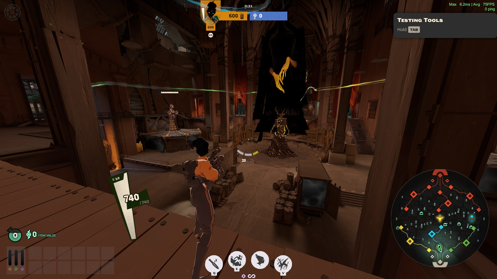
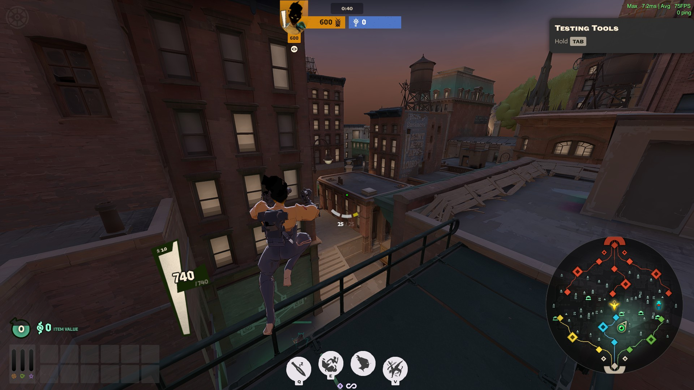
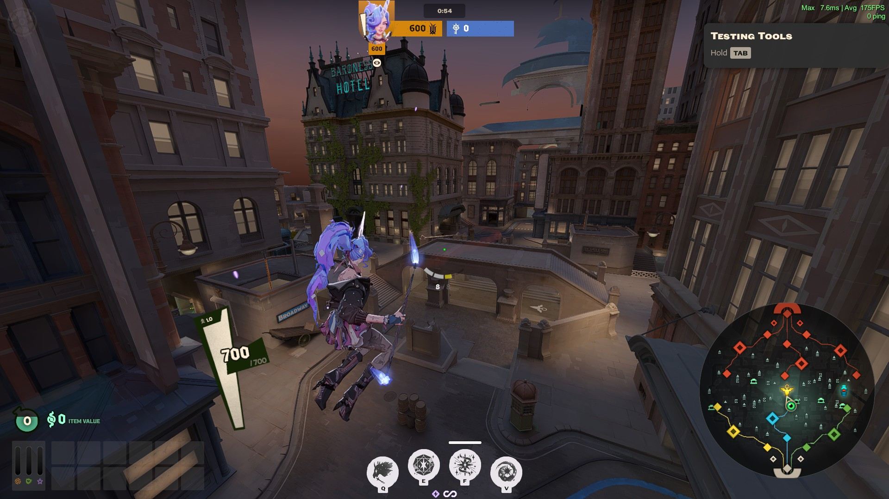
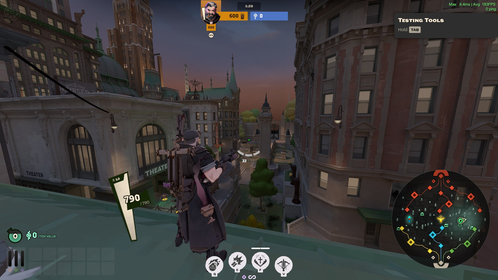
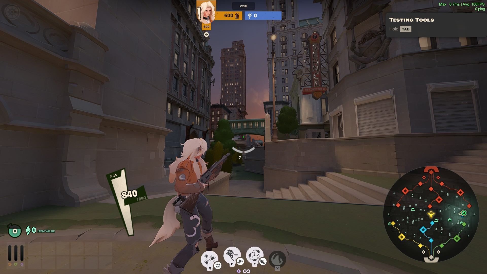
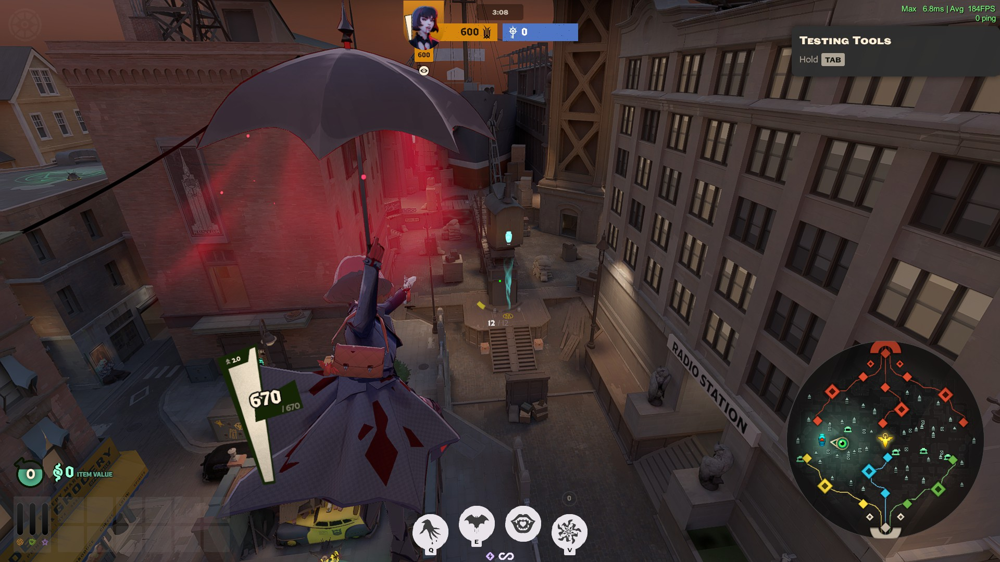
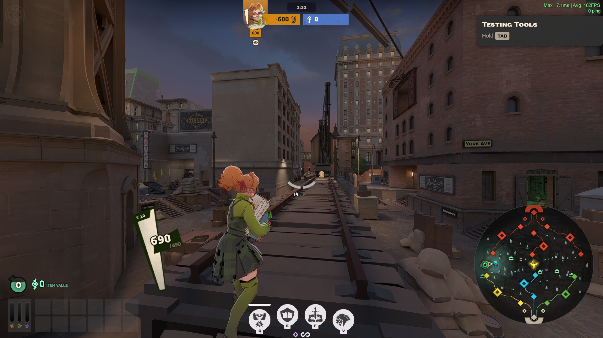
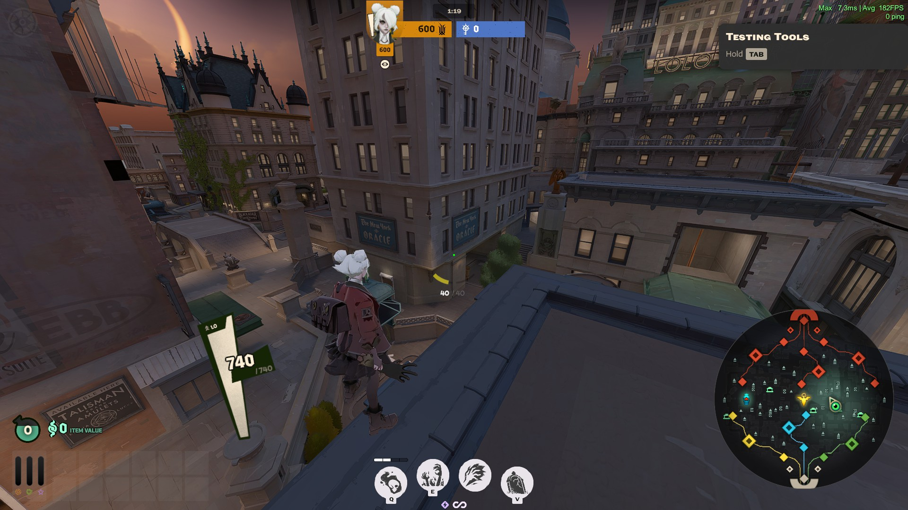

## Intro
This is Kaizuchanru's fps config. It reduces visual quality pretty severly with the goal of maxxing out fps

Included is also a version titled "gameinfoextremelow.gi"
extreme-low has postprocessing and colorcorrection disabled that makes the game darker and greyer but yield a bit better performance 

https://www.twitch.tv/kaizuchaneru
https://ko-fi.com/kaizuchaneru

find your citadel folder: \steam\steamapps\common\Deadlock\game\citadel
replace your gameinfo.gi with one of these gameinfo.gi
if you download the EXTREME-LOW then remove "-EXTREME-LOW" in the file name
If there are any errors, it's your outdated mods. Configs are updated and tested to make sure it works before it gets shipped.

Tiếng Việt:
Tìm folder citadel: \steam\steamapps\common\Deadlock\game\citadel
Thay gameinfo.gi trong folder bằng 1 trong 2 cái gameinfo này
Nếu download EXTREME-LOW thì nhớ xóa phần "-EXTREME-LOW" trong tên file
Nếu có lỗi gì thì chỉ có thể do mod, gameinfo được update và test thường xuyên để chắc chắn game sẽ chơi được an toàn

## Screenshots
<meta http-equiv="content-type" content="text/html; charset=utf-8">
<meta http-equiv="content-type" content="text/html; charset=utf-8">
<meta http-equiv="content-type" content="text/html; charset=utf-8">
<meta http-equiv="content-type" content="text/html; charset=utf-8">
<meta http-equiv="content-type" content="text/html; charset=utf-8">
<meta http-equiv="content-type" content="text/html; charset=utf-8">
<meta http-equiv="content-type" content="text/html; charset=utf-8">
<meta http-equiv="content-type" content="text/html; charset=utf-8">
